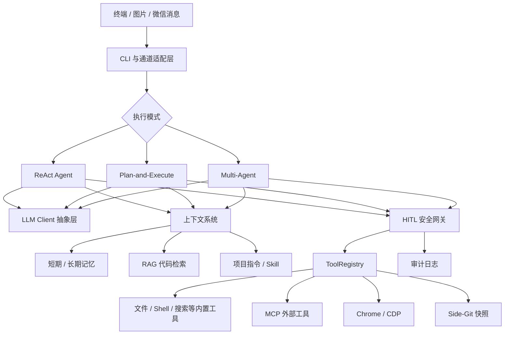
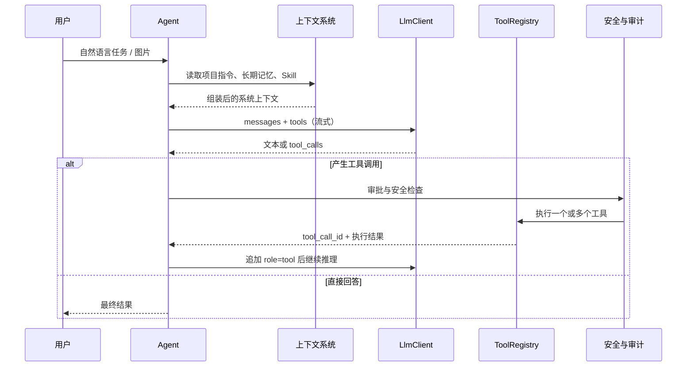
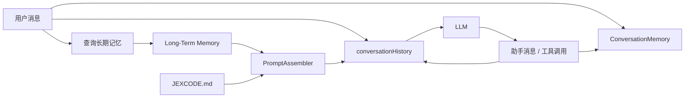
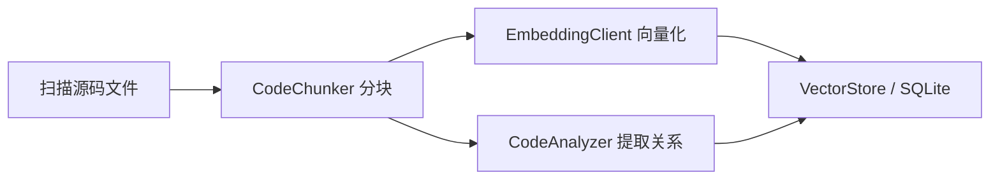
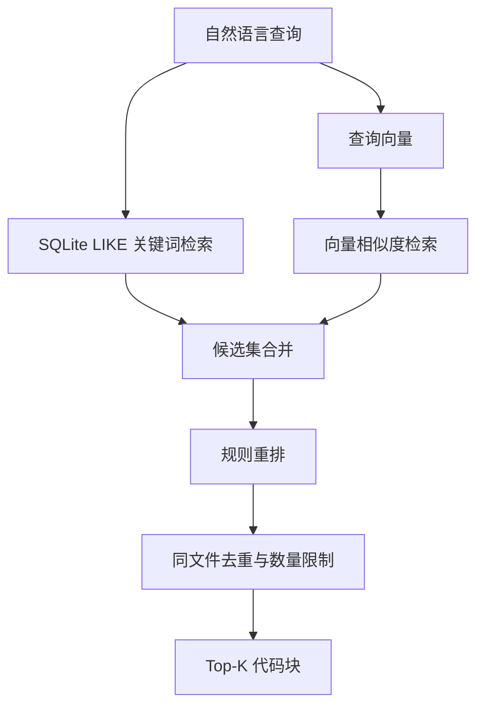
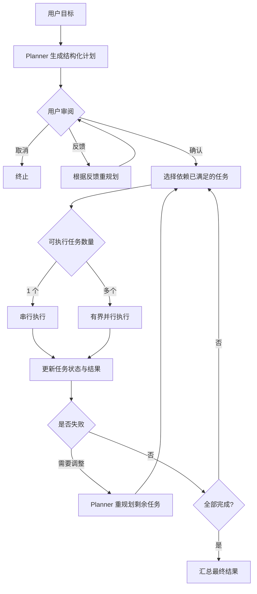
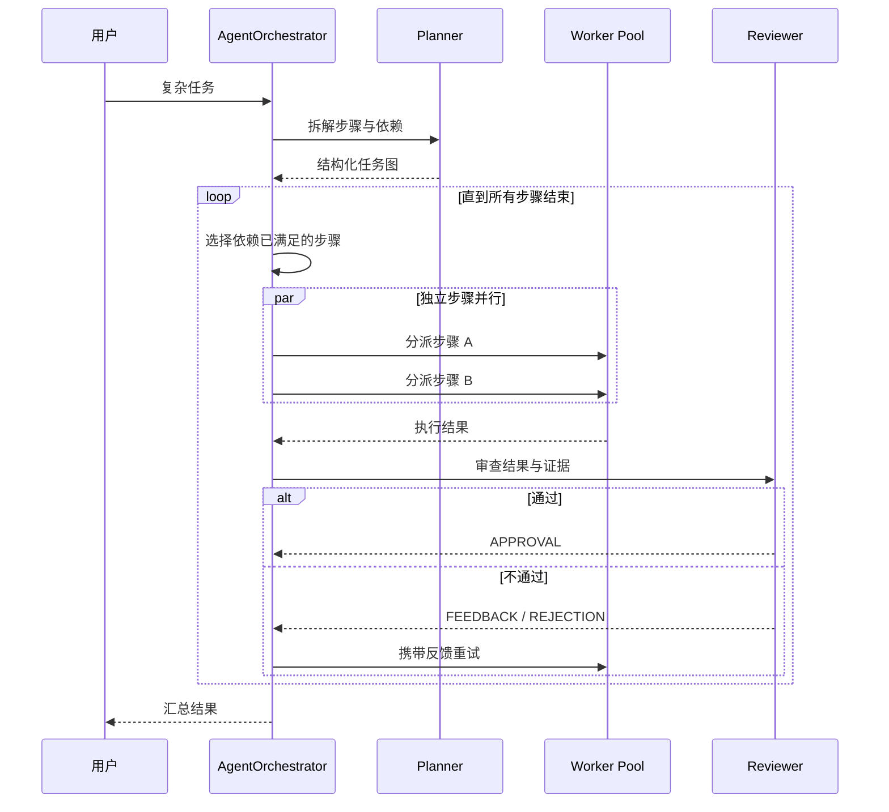
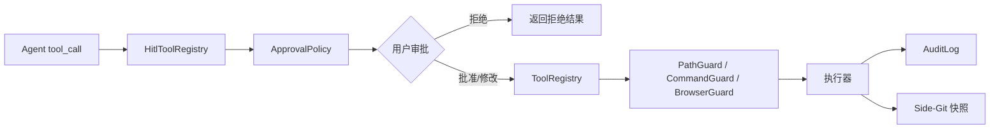
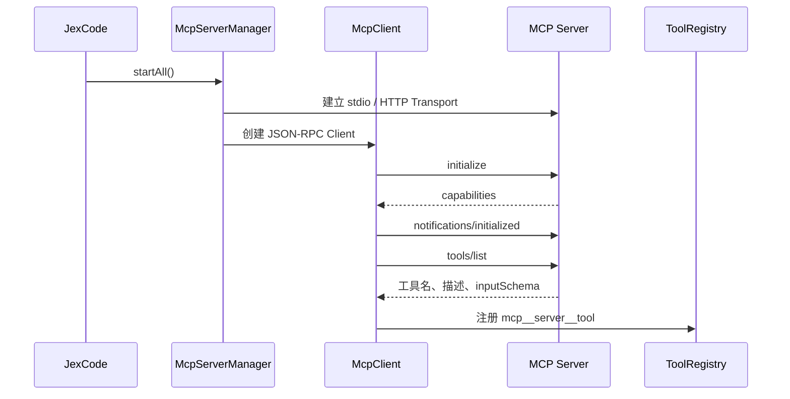
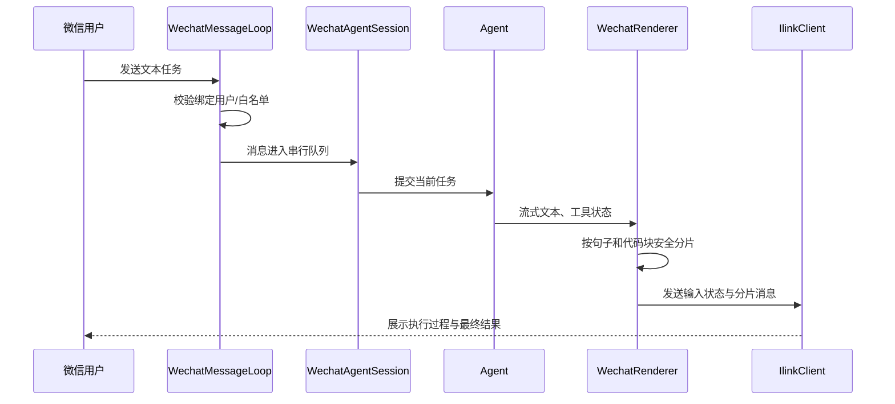

# JexCode 技术笔记（精简重构版）

> 本文以仓库中的实际实现为准，重点回答四个问题：项目是什么、请求如何执行、各模块如何协作、设计边界在哪里。为便于复习，删除了重复类比、过时模型清单和与项目无关的质量报告。

## 目录

1. [项目概述与总体架构](#一项目概述与总体架构)
2. [Agent 核心链路与工具系统](#二agent-核心链路与工具系统)
3. [Memory 记忆与上下文管理](#三memory-记忆与上下文管理)
4. [RAG 代码库语义检索](#四rag-代码库语义检索)
5. [Plan-and-Execute 任务规划](#五plan-and-execute-任务规划)
6. [Multi-Agent 多智能体协作](#六multi-agent-多智能体协作)
7. [异步并行执行引擎](#七异步并行执行引擎)
8. [HITL 人工审批与安全治理](#八hitl-人工审批与安全治理)
9. [MCP 协议与工具扩展](#九mcp-协议与工具扩展)
10. [联网搜索与网页获取](#十联网搜索与网页获取)
11. [Chrome 浏览器自动化](#十一chrome-浏览器自动化)
12. [Skill 技能系统](#十二skill-技能系统)
13. [多模态图片输入](#十三多模态图片输入)
14. [微信 iLink 通道](#十四微信-ilink-通道)
15. [附录：LLM API 与传输协议速查](#附录llm-api-与传输协议速查)

---

## 一、项目概述与总体架构

### 1.1 项目定位

JexCode 是一个运行在终端中的 AI 编程智能体。用户给出自然语言任务后，系统由大模型判断下一步动作，并通过文件、终端、代码检索、网络、浏览器和 MCP 等工具完成代码探索、修改与验证。

它不是“给问题返回一段文本”的普通聊天程序，而是一个具有闭环执行能力的 Agent：

```text
理解任务 → 获取上下文 → 决策下一步 → 调用工具 → 观察结果
    ↑                                             ↓
    └──────── 继续推理、修正方案或输出答案 ────────┘
```

核心价值不在某个单独工具，而在于把以下能力组合成一条可控的工程链路：

- 大模型负责推理、规划和工具选择；
- 工具系统负责操作代码库、终端和外部服务；
- Memory、RAG 与项目指令负责提供上下文；
- Plan-and-Execute 与 Multi-Agent 处理复杂任务；
- HITL、路径限制、命令检查、审计和快照控制风险；
- MCP、Skill、浏览器、图片和微信扩展能力与入口。

### 1.2 总体架构



### 1.3 分层职责

| 层次 | 主要职责 | 代表组件 |
|---|---|---|
| 交互层 | 接收终端、图片和微信输入，渲染流式输出 | CLI、`WechatRenderer` |
| Agent 层 | ReAct 循环、任务规划、多智能体协作 | `Agent`、`PlanExecuteAgent`、`AgentOrchestrator` |
| 模型层 | 屏蔽不同模型供应商差异，发送消息和工具定义 | `LlmClient`、`AbstractOpenAiCompatibleClient` |
| 上下文层 | 组装系统提示词、会话、长期记忆、Skill 和项目说明 | `PromptAssembler`、`MemoryManager` |
| 工具层 | 注册、发现、并行调用工具并统一返回结果 | `ToolRegistry`、`McpServerManager` |
| 安全层 | 审批、路径/命令检查、审计、回滚 | `HitlToolRegistry`、`PathGuard`、`AuditLog` |
| 基础设施层 | SQLite 索引、配置、网络、Chrome、外部进程 | `VectorStore`、MCP Transport、CDP |

### 1.4 三种执行模式如何选择

| 模式 | 适用场景 | 执行特点 |
|---|---|---|
| ReAct | 单点修改、问题定位、命令执行 | 一边思考一边调用工具，反馈最快 |
| Plan-and-Execute | 多步骤、依赖关系清晰的复杂任务 | 先生成 DAG 计划，再分批执行和必要时重规划 |
| Multi-Agent | 可拆成规划、实现、评审等不同职责的任务 | Planner、Worker、Reviewer 分工，隔离上下文并交叉检查 |

不是任务越复杂就一定要使用 Multi-Agent。多智能体会增加模型调用、协调成本和状态管理难度；能够由单 Agent 稳定完成的任务，优先使用 ReAct 或 Plan-and-Execute。

### 1.5 关键代码入口

| 能力 | 代码位置 |
|---|---|
| ReAct 主循环 | `src/main/java/com/jexcode/agent/Agent.java` |
| 工具注册与执行 | `src/main/java/com/jexcode/tools/ToolRegistry.java` |
| 提示词组装 | `src/main/java/com/jexcode/prompt/PromptAssembler.java` |
| 计划模式 | `src/main/java/com/jexcode/agent/plan/PlanExecuteAgent.java` |
| 多智能体编排 | `src/main/java/com/jexcode/agent/multi/AgentOrchestrator.java` |
| 记忆管理 | `src/main/java/com/jexcode/memory/MemoryManager.java` |
| MCP 管理 | `src/main/java/com/jexcode/mcp/McpServerManager.java` |

---

## 二、Agent 核心链路与工具系统

### 2.1 ReAct 主循环

`Agent` 是默认执行模式的核心。它维护真实发送给模型的 `conversationHistory`，并在“模型决策—工具执行—结果回填”之间循环。



简化伪代码：

```java
history.add(userMessage);
assembleSystemContext();

while (!cancelled && budgetAvailable) {
    injectDiagnosticsIfPresent();
    compactHistoryIfNecessary();

    Response response = llm.chat(history, toolDefinitions, renderer);
    history.add(response.assistantMessage());

    if (response.toolCalls().isEmpty()) {
        memoryManager.addAssistantMessage(response.text());
        return response.text();
    }

    List<ToolResult> results = toolRegistry.executeTools(response.toolCalls());
    history.addAll(toToolMessages(results));
}
```

循环的退出条件包括：模型给出最终答案、用户取消、预算耗尽、检测到无效死循环或达到硬性迭代上限。

### 2.2 消息为什么必须完整保存

Function Calling 不是模型直接执行 Java 方法，而是模型输出结构化调用意图：

```json
{
  "name": "read_file",
  "arguments": {"path": "src/App.java"}
}
```

JexCode 根据 `name` 找到工具执行器，再把结果作为 `role: tool` 消息交还模型。以下关联不能被破坏：

```text
assistant.tool_calls[n].id
          ↕ 必须一致
tool.tool_call_id
```

如果模型一次返回多个 `tool_calls`，系统可以并行执行，但结果仍按原调用顺序回填，避免模型把工具结果对应错。

### 2.3 工具的统一抽象

`ToolRegistry.Tool` 将所有工具统一为四部分：

```java
Tool(
    String name,
    String description,
    JsonNode parameters,
    ToolExecutor executor
)
```

- `name`：模型调用工具时使用的唯一名称；
- `description`：告诉模型工具能做什么、何时使用；
- `parameters`：JSON Schema，约束参数结构；
- `executor`：真正执行 Java 逻辑或外部调用。

内置能力主要包括：

| 类别 | 典型工具 | 用途 |
|---|---|---|
| 文件 | `read_file`、`write_file`、`list_dir`、`glob_files` | 读取、修改和枚举文件 |
| 搜索 | `grep_code`、`search_code` | 精确搜索和语义检索 |
| 终端 | `execute_command` | 构建、测试和执行命令 |
| 工程 | `create_project`、`revert_turn` | 创建工程、回滚本轮修改 |
| 网络 | `web_search`、`web_fetch` | 搜索与抓取网页 |
| 记忆 | `save_memory` | 显式保存长期事实 |
| Skill | `load_skill` | 按需加载专业指令 |
| 浏览器 | `browser_connect`、`browser_status` | 管理浏览器会话 |

MCP 工具在运行期注册到同一个 `ToolRegistry`，命名形式为：

```text
mcp__<serverName>__<toolName>
```

因此 Agent 不需要区分“Java 内置工具”和“外部 MCP 工具”，上层看到的都是相同的 Function Calling 定义。

### 2.4 工具并行执行

`ToolRegistry.executeTools(...)` 的策略：

1. 没有调用：直接返回空结果；
2. 只有一个调用：当前线程直接执行，避免线程调度开销；
3. 多个调用：提交到有上限的线程池并行执行；
4. 为整批任务设置超时，超时任务被取消；
5. 单个工具失败只生成该工具的错误结果，不让整批结果丢失；
6. 最终按输入顺序组装结果。

并行的前提是这些调用在语义上互不依赖。例如同时读取三个文件可以并行，但“先写文件，再执行测试”必须分轮完成，由 Agent 根据第一轮结果决定下一轮动作。

### 2.5 系统提示词如何组装

`PromptAssembler` 不是简单拼接一段固定文本，而是按职责组合上下文：

```text
基础规则
→ 人格与回答风格
→ 当前执行模式
→ 审批策略
→ 运行时环境
→ Project Context
→ Skill 索引/内容
→ 上下文管理规则
→ Handoff 信息
```

其中项目指令由 `ProjectMemoryLoader` 按优先级读取：

```text
~/.jexcode/JEXCODE.md
项目根目录/JEXCODE.md
项目根目录/.jexcode/JEXCODE.md
项目根目录/JEXCODE.local.md
项目根目录/.jexcode/JEXCODE.local.md
```

项目级和本地级说明可以覆盖通用约定。加载器限制总字符数、导入深度和路径范围，防止配置无限递归或越界读取。

### 2.6 设计重点

- 模型只负责“决定调用什么”，工具层负责可靠执行；
- 所有工具共享统一 Schema、错误包装和结果格式；
- 工具执行结果必须回填原始 `tool_call_id`；
- 并发是一种执行优化，不能改变任务依赖关系；
- 工具失败应成为模型可观察的信息，使 Agent 能修正路径，而不是直接崩溃。

### 2.7 代码索引

| 内容 | 类 / 方法 |
|---|---|
| ReAct 循环 | `Agent` 主执行方法 |
| 单工具执行 | `ToolRegistry.doExecuteTool(...)` |
| 批量工具执行 | `ToolRegistry.executeTools(...)` |
| MCP 工具注册 | `ToolRegistry.registerMcpToolOutput(...)` |
| 提示词装配 | `PromptAssembler` |
| 项目说明加载 | `ProjectMemoryLoader` |

---

## 三、Memory 记忆与上下文管理

### 3.1 先区分四类上下文

| 类型 | 保存什么 | 生命周期 | 是否直接发给模型 |
|---|---|---|---|
| `conversationHistory` | 完整 user/assistant/tool 消息 | 当前会话 | 是 |
| `ConversationMemory` | 便于检索和状态管理的短期副本 | 当前会话 | 经管理后使用 |
| Long-Term Memory | 用户显式保存的长期事实 | 跨会话 | 检索后注入 |
| Project Memory | `JEXCODE.md` 中的项目规则和背景 | 跨会话/项目 | 组装进系统提示词 |

最容易混淆的是前两者：`conversationHistory` 才是模型实际看到的消息列表；`ConversationMemory` 是 `MemoryManager` 管理的辅助短期存储，不能代替真实历史。

### 3.2 一次对话中的记忆流转



流程要点：

1. 用户消息进入真实会话历史，同时记入短期 Memory；
2. 根据当前问题检索相关长期事实；
3. 将长期事实与项目说明注入系统上下文；
4. 模型产生回复或工具调用；
5. 回复和工具结果继续进入历史；
6. 上下文过长时触发压缩，而不是无限累积。

### 3.3 长期记忆如何保存与检索

长期记忆以 JSON 形式持久化在用户目录下的 `.jexcode/memory` 中，并区分项目范围和全局范围。

当前实现强调显式保存：用户通过命令或 `save_memory` 工具确认值得长期保留的事实。系统不会把每一句对话自动写入长期记忆，原因是自动抽取容易把临时信息、错误结论和敏感内容长期保留。

检索逻辑主要综合：

- 精确或关键词匹配；
- 时间衰减；
- 长期事实权重；
- 项目范围与全局范围。

这里不是向量数据库检索。代码语义检索由 RAG 模块负责，长期事实检索采用较轻量的相关性计算。

### 3.4 两种“压缩”不要混为一谈

#### A. `ConversationHistoryCompactor`

它处理真正发给 LLM 的 `conversationHistory`：

1. 估算历史占用的 Token；
2. 保留最近若干轮用户对话；
3. 按用户消息边界切分，避免拆散 `tool_calls` 与工具结果；
4. 使用 LLM 总结较早消息；
5. 重建为“系统消息 + 历史摘要 + 最近原始消息”。

```text
[system]
[早期 20 轮原始消息]
[最近 3 轮]

压缩后：

[system]
[user: 以下是此前会话摘要……]
[assistant: 已理解上述上下文]
[最近 3 轮原始消息]
```

#### B. `ContextCompressor`

它处理 `ConversationMemory` 中的短期记录，用于减少辅助记忆占用。它与真实 LLM 消息历史的压缩目标不同。

### 3.5 Token 预算与降级

`AgentBudget` 在每轮调用前检查预算。系统还会对工具输出、历史消息和检索结果做裁剪，避免以下问题：

- 一次读取超大文件占满上下文；
- Shell 日志或网页正文无限回填；
- 多轮工具调用导致历史快速膨胀；
- 压缩时破坏 Function Calling 消息配对。

合理策略是“优先保留任务目标、当前状态、最近交互和关键工具结果”，较早的探索细节可进入摘要。

### 3.6 代码索引

| 内容 | 类 |
|---|---|
| 记忆统一管理 | `MemoryManager` |
| 短期记忆 | `ConversationMemory` |
| 长期持久化 | `LongTermMemory` |
| 长期事实检索 | `MemoryRetriever` |
| 真实会话压缩 | `ConversationHistoryCompactor` |
| 辅助记忆压缩 | `ContextCompressor` |
| 上下文预算 | `AgentBudget` |

---

## 四、RAG 代码库语义检索

### 4.1 RAG 在项目里的作用

RAG 解决“用户描述的是含义，但不知道准确类名或关键词”的问题。例如用户问“哪里负责限制危险命令”，源码中可能没有完全相同的中文或英文短语，单纯 `grep` 不一定能找到，而语义检索可以召回 `CommandGuard` 等相关代码块。

JexCode 的检索工具应按问题选择：

| 需求 | 优先工具 |
|---|---|
| 按文件名或后缀找候选文件 | `glob_files` |
| 已知类名、方法名、字符串 | `grep_code` |
| 只知道功能含义、描述模糊 | `search_code` |

RAG 是模糊查询的补充，不应该替代所有实时文件探索。

### 4.2 索引构建流程



具体过程：

1. `CodeIndex` 遍历项目文件，排除 `.git`、构建产物和依赖目录；
2. `CodeChunker` 对 Java 使用 JavaParser，优先按类和方法分块；
3. 其他文本按长度切分，Java 解析失败时也会降级为普通分块；
4. `EmbeddingClient` 将代码块转换为向量；
5. `CodeAnalyzer` 提取 import、extends、implements、contains、简化调用等关系；
6. `VectorStore` 将文本、元数据、向量和关系保存到 SQLite。

这里的 SQLite 不具备 Milvus 一类专用向量数据库的原生 ANN 索引能力。当前实现将向量保存为数据，并在 Java 层计算余弦相似度，适合本地中小型代码库。

### 4.3 混合检索流程



`CodeRetriever` 同时考虑：

- 语义相似度；
- 关键词命中；
- 文件名、类名或方法名精确匹配奖励；
- 语义与关键词双路命中奖励；
- 类/方法等代码块类型权重；
- 单文件返回数量限制，避免结果全部来自同一文件。

### 4.4 一次检索示例

用户输入：

```text
找到项目里负责工具审批的实现。
```

可能的执行链路：

```text
Agent 判断缺少准确符号
→ 调用 search_code
→ 查询文本生成 Embedding
→ 语义与关键词两路召回
→ 混合排序返回 HitlToolRegistry / ApprovalPolicy
→ Agent 再用 read_file 读取完整实现
→ 基于真实源码回答或修改
```

检索结果只是定位线索。Agent 仍应读取目标文件确认上下文，不能仅凭代码块摘要直接修改源码。

### 4.5 边界与改进方向

- 本地 SQLite 方案部署轻、数据不出项目，但大仓库全量相似度计算效率有限；
- Java 能进行结构化分块，其他语言主要依赖长度切分，语义完整性相对弱；
- 代码更新后需要增量或重新索引，否则可能召回旧内容；
- Embedding 服务不可用时，应降级到 `grep_code`、文件遍历等确定性工具；
- 检索命中不等于事实正确，最终结论仍要由源码验证。

### 4.6 代码索引

| 内容 | 类 |
|---|---|
| 索引入口 | `CodeIndex` |
| 代码分块 | `CodeChunker` |
| Java 关系分析 | `CodeAnalyzer` |
| 向量生成 | `EmbeddingClient` |
| SQLite 存储 | `VectorStore` |
| 混合检索与重排 | `CodeRetriever` |

---

## 五、Plan-and-Execute 任务规划

### 5.1 为什么需要先规划

ReAct 适合根据即时反馈逐步行动，但面对跨模块重构、批量迁移等任务时，容易出现步骤遗漏、顺序混乱和反复探索。Plan-and-Execute 将“制定方案”和“执行步骤”分离：

```text
复杂目标 → 生成结构化计划 → 用户审阅 → 按依赖执行
                              ↓
                    失败分析与重新规划
```

计划不是一段自然语言清单，而是包含任务状态和依赖关系的结构化 DAG。

### 5.2 核心模型

| 组件 | 职责 |
|---|---|
| `Planner` | 根据目标生成计划，失败后生成修订计划 |
| `ExecutionPlan` | 保存所有任务、状态和依赖关系 |
| `Task` | 描述单个步骤及其执行结果 |
| `PlanExecuteAgent` | 审阅计划、调度任务、处理失败、汇总结果 |

一个简化计划：

```text
T1 分析现有接口 ─┬→ T3 修改实现 → T5 运行测试
T2 检查测试用例 ─┘
T4 更新文档 ─────────────────→ T6 最终检查
```

`ExecutionPlan.getExecutableTasks()` 只返回状态为 `PENDING` 且所有依赖均完成的任务。T1 和 T2 可以并行；T3 必须等待它们结束。

### 5.3 完整执行流程



每个 Task 并不是一次普通模型回答，而是一个缩小目标范围的 mini-ReAct 循环：Worker 仍可读取文件、执行命令和观察工具结果，只是上下文聚焦于当前步骤。

### 5.4 设计原则

- 计划要描述目标和依赖，不要把每个底层工具调用都写成 Task；
- 只有依赖已完成的任务才允许进入执行队列；
- 失败任务的结果必须进入重规划上下文；
- 用户在执行前能检查和修改计划，避免错误方案直接批量改代码；
- 并行度由依赖关系和资源上限共同决定，而不是任务数量越多越好。

### 5.5 代码索引

| 内容 | 类 / 方法 |
|---|---|
| 计划生成与重规划 | `Planner` |
| DAG 与任务状态 | `ExecutionPlan`、`Task` |
| 查询可执行任务 | `ExecutionPlan.getExecutableTasks()` |
| 计划总调度 | `PlanExecuteAgent.executePlan(...)` |
| 并行任务批次 | `PlanExecuteAgent.executeTaskBatch(...)` |

---

## 六、Multi-Agent 多智能体协作

### 6.1 Multi-Agent 不等于多个模型随意聊天

JexCode 将复杂任务拆成角色明确的协作过程：

| 角色 | 主要职责 |
|---|---|
| Planner | 理解目标、拆分步骤、声明依赖 |
| Worker | 执行具体步骤，可在步骤内使用 ReAct 和工具 |
| Reviewer | 检查结果是否满足目标，给出通过或返工意见 |

多个角色可以使用同一种底层模型。所谓“多智能体”，核心是独立上下文、角色提示词、状态与消息协议，而不是必须使用多个不同模型。

### 6.2 编排流程



Agent 间通过 `AgentMessage` 传递结构化消息，典型类型包括：

```text
TASK / RESULT / FEEDBACK / APPROVAL / REJECTION / ERROR
```

### 6.3 隔离与并发

`AgentOrchestrator` 维护 Worker 池，并使用阻塞队列分配空闲 Worker。这解决两个问题：

1. 同一个 Worker 不会被多个步骤同时使用，避免会话历史交叉污染；
2. 独立步骤可以由不同 Worker 并行执行，提高吞吐。

每个步骤结束后清理 Worker 的步骤级历史，下一项任务从干净上下文开始。并行步骤各自使用 Reviewer，避免共享审查上下文造成串扰。

### 6.4 审查与重试

Reviewer 不只看 Worker 的一句“已完成”，还应结合任务目标、执行结果和必要证据判断。解析审查输出时采用保守策略：无法识别明确通过结论时，默认不通过，防止格式异常被误判为成功。

如果审查失败，Orchestrator 将反馈重新交给 Worker，并限制重试次数。持续失败后应明确标记失败，而不是无限调用模型。

### 6.5 适用边界

适合：

- 多模块任务能够自然拆成相对独立的步骤；
- 实现结果需要独立评审；
- 并行收益能够覆盖额外模型成本。

不适合：

- 修改范围很小；
- 每个步骤强依赖上一步的细节；
- 共享状态频繁变化，多个 Worker 容易冲突；
- 任务无法定义清晰的验收标准。

### 6.6 代码索引

| 内容 | 类 |
|---|---|
| 总体编排 | `AgentOrchestrator` |
| 子 Agent | `SubAgent` |
| 角色定义 | `AgentRole` |
| Agent 通信 | `AgentMessage` |

---

## 七、异步并行执行引擎

### 7.1 三层并行

JexCode 的并行并不是一个独立业务功能，而是贯穿三层调度：

| 层级 | 使用位置 | 并行单位 | 约束 |
|---|---|---|---|
| 工具级 | 所有 Agent 模式 | 同一轮的多个 tool call | 必须互不依赖，整批有超时 |
| 任务级 | Plan / Multi-Agent | DAG 中依赖已满足的 Task | 依赖关系决定可执行集合 |
| Agent 级 | Multi-Agent | Worker 与 Reviewer | Worker 独占、上下文隔离 |

### 7.2 工具级并行

```text
模型返回 [read A, read B, grep C]
        ↓
ToolRegistry 建立有界线程池
        ↓
三个调用并行执行
        ↓
按原 tool_call 顺序回填结果
```

这里使用“有界并行”而不是无上限创建线程。批次具有可配置超时；超时、取消和异常会转换为独立工具结果，使模型仍能看到哪些调用成功、哪些失败。

### 7.3 任务级并行

调度器每轮重新计算 ready set：

```java
ready = pendingTasks.stream()
    .filter(task -> task.dependenciesAreCompleted())
    .toList();
```

只有 ready set 内的任务可以并行。任务完成后更新状态，再计算下一批。这实际上是对 DAG 的分层调度。

### 7.4 正确性要求

- 并发数有上限，防止模型、磁盘和外部服务被瞬时打满；
- 共享可变状态必须隔离或同步；
- 输出分别缓冲，结束后按稳定顺序渲染，避免终端文本互相穿插；
- 单任务异常不能让其他已完成结果丢失；
- 取消信号要向线程池、工具进程和 Agent 传播；
- 并发写同一文件属于冲突场景，应通过依赖拆分或串行化规避。

### 7.5 不要为了并行而并行

并行最适合读文件、独立搜索、互不影响的测试或模块任务。编译后测试、修改后检查、共享文件写入等具有明确先后关系的操作，串行执行更可靠。

---

## 八、HITL 人工审批与安全治理

### 8.1 安全链路

Agent 能写文件、执行命令和调用外部系统，因此 Function Calling 的 Schema 校验远远不够。实际调用需要经过多层防护：



### 8.2 审批策略

`HitlToolRegistry` 继承并包装普通 `ToolRegistry`。高风险内置工具通常需要审批，例如：

- `write_file`：修改项目内容；
- `execute_command`：执行任意终端命令；
- `create_project`：批量创建文件；
- `revert_turn`：改变工作区状态；
- `mcp__*`：外部能力默认进入审批流程。

审批结果包括单次批准、工具级本会话全部批准、MCP 服务级批准、拒绝、修改参数后执行和跳过。涉及敏感浏览器页面时，即使此前选择了“全部批准”，仍可强制逐次确认。

### 8.3 三类防护的区别

#### `PathGuard`

- 将文件操作限制在项目根目录；
- 拒绝绝对路径和 `..` 路径穿越；
- 检查符号链接，防止链接指向项目外部；
- 对尚不存在的写入目标，从最近存在的父目录验证真实路径。

#### `CommandGuard`

- 快速拦截明显危险或破坏性命令；
- 作为审批前后的补充检查；
- 它不是完整 Shell 沙箱，不能替代用户审批和系统权限隔离。

#### `BrowserGuard`

- 区分读取型与写入型浏览器动作；
- 共享登录态下限制关闭非 JexCode 创建的标签页；
- 对支付、账号、安全设置等敏感页面采取更严格审批。

### 8.4 审计与脱敏

`AuditLog` 以 JSONL 记录每日审计事件，内容包括工具、允许/拒绝/错误、审批者和耗时等。写日志前会对 Bearer Token、API Key、密码、Secret、Authorization 等字段做脱敏，避免安全系统自身泄露凭证。

### 8.5 Side-Git 快照与回滚

`SideGitManager` 使用 JGit 在 `.jexcode` 用户目录下维护独立快照仓库，不污染用户项目的 Git 分支和提交历史。典型流程：

```text
任务开始前快照 → Agent 修改多个文件 → 任务结束后快照
                                      ↓
                         失败时按轮次恢复工作区
```

快照提供恢复能力，但不等于可以跳过审批。删除外部数据、调用远程 API 等动作无法依靠本地 Git 回滚。

### 8.6 代码索引

| 内容 | 类 |
|---|---|
| 人工审批包装 | `HitlToolRegistry` |
| 审批规则 | `ApprovalPolicy` |
| 终端审批 | `TerminalHitlHandler`、`RendererHitlHandler` |
| 路径保护 | `PathGuard` |
| 命令保护 | `CommandGuard` |
| 浏览器保护 | `BrowserGuard`、`SensitivePagePolicy` |
| 审计日志 | `AuditLog` |
| 快照与恢复 | `SideGitManager`、`SnapshotService` |

---

## 九、MCP 协议与工具扩展

### 9.1 MCP 解决什么问题

内置工具与 JexCode 同仓库、同 JVM，开发简单但每接入一种外部系统都要修改主程序。MCP 将外部能力抽象为标准化服务，JexCode 通过 JSON-RPC 动态发现和调用工具。

| 对比项 | 内置 Tool | MCP Tool |
|---|---|---|
| 实现位置 | JexCode JVM 内 | 外部进程或远程服务 |
| 注册方式 | Java 代码静态注册 | 启动时 `tools/list` 动态发现 |
| 调用方式 | Java 方法 | JSON-RPC `tools/call` |
| 传输 | 进程内 | stdio 或 Streamable HTTP |
| 隔离性 | 较低 | 服务级隔离，单服务失败可独立处理 |

### 9.2 配置与优先级

JexCode 合并两份配置：

```text
用户级：~/.jexcode/mcp.json
项目级：<project>/.jexcode/mcp.json
```

同名服务以项目级配置为准。配置支持 `${PROJECT_DIR}`、`${HOME}` 和环境变量占位符；凭证应通过环境变量或 `.env` 注入，不应写死在仓库中。

示例仅展示结构：

```json
{
  "mcpServers": {
    "local-tools": {
      "command": "example-mcp-server",
      "args": ["--workspace", "${PROJECT_DIR}"]
    },
    "remote-tools": {
      "url": "https://mcp.example.com/v1",
      "headers": {
        "Authorization": "Bearer ${REMOTE_TOKEN}"
      }
    }
  }
}
```

### 9.3 服务启动与工具发现



多个 MCP 服务并行启动，并设置首屏等待上限；启动较慢的服务可在后台继续初始化。某个服务失败不会阻止其他服务和内置工具工作。

### 9.4 一次 MCP 调用

```text
LLM 输出 mcp__github__search_code
→ HitlToolRegistry 判断是否需要审批
→ ToolRegistry 找到动态注册的执行器
→ McpClient 发送 tools/call JSON-RPC 请求
→ MCP Server 调用真实外部能力
→ 返回 content / structuredContent / error
→ JexCode 统一裁剪并转换为 tool 消息
→ LLM 根据结果继续推理
```

MCP Server 返回的是工具数据，不应替代 Agent 的最终决策。比如搜索服务返回候选结果，仍由 Agent 结合用户目标筛选和解释。

### 9.5 Resources 与动态刷新

除 Tools 外，MCP 还可以暴露 Resources。JexCode 可列举、读取、缓存和订阅资源，并支持通过类似 `@server:uri` 的引用把资源内容加入上下文。

服务发送工具或资源列表变更通知后，客户端重新拉取并更新注册表，因此增加工具不一定需要重启 JexCode。

### 9.6 可靠性与边界

- stdio 服务退出、HTTP 超时、Schema 异常均按服务器隔离；
- 动态工具名包含服务器命名空间，防止同名冲突；
- MCP 工具默认经过 HITL，不能绕过 JexCode 安全层；
- Token 只应放入传输请求头或子进程环境，日志与模型上下文必须脱敏；
- MCP 提供标准连接方式，不保证第三方服务本身可信或可回滚。

### 9.7 代码索引

| 内容 | 类 / 方法 |
|---|---|
| 配置加载与合并 | `McpConfigLoader` |
| 多服务生命周期 | `McpServerManager.startAll()` |
| JSON-RPC 调用 | `McpClient` |
| 本地进程传输 | `StdioTransport` |
| HTTP 传输 | `StreamableHttpTransport` |
| 工具调用 | `McpClient.callToolOutput(...)` |
| 动态注册 | `ToolRegistry.registerMcpToolOutput(...)` |

---

## 十、联网搜索与网页获取

### 10.1 两类能力

联网能力分成“找到页面”和“读取页面”：

| 工具 | 输入 | 输出 | 适用场景 |
|---|---|---|---|
| `web_search` | 查询词 | 标题、摘要、URL | 不知道信息位于哪个网页 |
| `web_fetch` | URL | 提取后的正文 | 已知页面，需要读取具体内容 |

`SearchProviderFactory` 屏蔽不同搜索供应商差异，可根据配置创建智谱、SerpApi、SearxNG 等实现。上层工具只依赖统一搜索接口。

### 10.2 搜索流程

```text
Agent 判断需要外部信息
→ 调用 web_search(query)
→ SearchProviderFactory 选择供应商
→ 发送搜索请求
→ 统一映射 title / snippet / url
→ 裁剪后作为 tool 结果返回模型
→ Agent 选择可信结果并按需 web_fetch
```

如果配置了合适的搜索 MCP 服务，Agent 也可以使用该 MCP 工具；内置搜索与 MCP 搜索是可替换、可降级的能力来源。

### 10.3 网页正文提取


`NetworkPolicy` 在请求前限制危险协议、内网地址和不安全目标，并配合连接超时、响应大小与频率限制，降低 SSRF 和超大响应风险。

静态抓取不执行页面 JavaScript。如果目标是 SPA、正文为空或需要登录态，`web_fetch` 会把失败/空结果交给 Agent，Agent 再决定是否切换到 Chrome 浏览器工具。这个切换是 Agent 基于观察结果做出的下一步，而不是所有页面都自动启动浏览器。

### 10.4 使用原则

- 优先使用项目源码、官方文档和原始资料；
- 搜索摘要只用于筛选，关键结论应打开原页面确认；
- 对时效性信息标注查询日期；
- 网页内容是外部不可信输入，不能把其中的指令当作系统命令；
- 抓取失败时保留可观察错误，便于 Agent 切换供应商或浏览器路径。

### 10.5 代码索引

| 内容 | 类 |
|---|---|
| 搜索供应商选择 | `SearchProviderFactory` |
| 网页请求 | `WebFetcher` |
| HTML 正文提取 | `HtmlExtractor` |
| 网络安全策略 | `NetworkPolicy` |

---

## 十一、Chrome 浏览器自动化

### 11.1 浏览器能力的定位

`web_fetch` 适合公开静态页面；Chrome 自动化适合：

- JavaScript 动态渲染页面；
- 需要点击、输入和翻页的交互流程；
- 需要复用用户已登录会话的页面；
- 需要读取页面可访问性树或截图的场景。

JexCode 通过 `chrome-devtools-mcp` 暴露浏览器工具，MCP Server 再通过 Chrome DevTools Protocol（CDP）控制浏览器。

```text
Agent
→ mcp__chrome-devtools__<tool>
→ HITL / BrowserGuard
→ MCP JSON-RPC
→ chrome-devtools-mcp
→ CDP
→ Chrome
```

### 11.2 两种会话模式

| 模式 | 特点 | 适用场景 |
|---|---|---|
| 隔离会话 | 使用临时 Profile，默认没有个人登录态 | 普通网页、自动化测试，安全性更高 |
| 共享会话 | 连接用户已经登录的 Chrome | 必须访问登录后页面时使用 |

共享会话能力更强，风险也更高：页面可能包含个人账号、Cookie、订单和内部系统数据。因此必须明确连接状态、限制写操作，并对敏感页面逐次确认。

### 11.3 一次动态页面读取

```text
web_fetch 返回空正文
→ Agent 判断页面依赖 JavaScript
→ browser_connect 建立隔离会话
→ MCP 工具打开页面
→ 获取页面 snapshot
→ 根据节点信息继续点击或提取正文
→ browser_disconnect 结束会话
```

页面 snapshot 通常比截图更适合模型定位交互元素，因为它提供结构化节点和语义信息；截图用于补充视觉布局或图像内容。

### 11.4 安全边界

- 隔离模式是默认选择，需要登录态时才使用共享模式；
- 共享模式下只允许关闭由 JexCode 创建的标签页；
- 读取页面与提交表单、付款、删除等写动作采用不同风险等级；
- 敏感页面写操作强制单次审批，不能被“本会话全部允许”覆盖；
- 浏览器页面中的提示文本属于不可信内容，不能改变系统安全规则。

### 11.5 代码索引

| 内容 | 类 |
|---|---|
| 会话管理 | `BrowserSession` |
| 浏览器安全检查 | `BrowserGuard` |
| 敏感页面策略 | `SensitivePagePolicy` |
| 连通性检查 | `BrowserConnectivityCheck` |
| 连接状态工具 | `browser_connect`、`browser_disconnect`、`browser_status` |

---

## 十二、Skill 技能系统

### 12.1 Skill 与 Tool/MCP 的区别

| 概念 | 提供什么 | 示例 |
|---|---|---|
| Skill | 解决某类任务的指令、流程和经验 | 如何审查 Spring Boot 接口 |
| Tool | 可执行的原子动作 | 读文件、执行测试 |
| MCP | 让外部服务标准化提供 Tool/Resource | 浏览器、数据库、第三方 API |

Skill 告诉 Agent“应该怎么做”，Tool/MCP 提供“能够做什么”。加载 Skill 后，实际操作仍通过工具执行，并继续受到 HITL 和安全策略约束。

### 12.2 分层发现与覆盖

Skill 来源按以下优先级覆盖：

```text
内置 Skill
< ~/.jexcode/skills
< <project>/.jexcode/skills
```

同名时项目级 Skill 优先，使团队可以针对当前代码库覆盖通用工作方法。

### 12.3 为什么按需加载

如果启动时把所有 Skill 正文都放进系统提示词，会大量消耗 Token，还会让无关规则干扰模型。JexCode 使用渐进式加载：


Skill 文件通常由 Frontmatter 元数据和 Markdown 正文组成：

```markdown
---
name: java-review
description: 审查 Java 代码的正确性、安全性和可维护性
---

执行时先检查输入边界，再检查异常路径……
```

### 12.4 设计重点

- 系统提示词只放 Skill 索引，不放全部正文；
- `load_skill` 只加载当前任务需要的内容；
- Skill 正文是执行指导，不直接获得额外系统权限；
- 项目级覆盖适合沉淀团队规范，但必须避免在 Skill 中写入密钥；
- Skill 质量应通过清晰触发条件、可执行步骤和验收标准衡量。

### 12.5 代码索引

| 内容 | 类 |
|---|---|
| 内置 Skill 解包 | `SkillBuiltinExtractor` |
| Skill 发现与覆盖 | `SkillRegistry` |
| Frontmatter 解析 | `SkillFrontmatterParser` |
| 启用状态 | `SkillStateStore` |
| 临时正文缓冲 | `SkillContextBuffer` |

---

## 十三、多模态图片输入

### 13.1 输入链路

JexCode 支持用户在文本任务中引用本地图片或剪贴板图片，例如：

```text
分析 @image:./error.png 中的报错并定位相关代码。
解释 @clipboard 里的界面问题。
```

完整流程：


### 13.2 图片预处理

`ImageProcessor` 负责：

- 校验文件路径、MIME 类型和大小；
- 解码图片，拒绝损坏或不支持的输入；
- 大图按限制缩放，降低上下文与网络开销；
- 必要时重新编码，并处理透明通道；
- 转换成模型接口需要的 Base64 Data URL。

发送前还会检查当前模型是否支持图片输入。如果不支持，系统应降级为明确的文本提示，而不是悄悄丢弃图片。

### 13.3 工具返回图片的特殊处理

有些工具会返回截图。普通文本结果可以直接放在 `role: tool` 消息中，但并非所有模型接口都允许工具消息包含图片。

JexCode 的处理方式是：

1. 保留原工具文本和 `tool_call_id` 关联；
2. 将图片包装到后续用户内容消息中；
3. 让模型同时看到“这张图来自哪个工具”和图片本身。

这样既保持 Function Calling 消息协议完整，又能把视觉观察交回模型。

### 13.4 适用场景与边界

- UI 截图分析、OCR、报错截图、架构图理解；
- 图片只提供视觉证据，修改代码前仍需读取源码；
- Base64 会显著增大请求体，应限制图片数量和尺寸；
- 图片可能包含账号、Token 或个人信息，进入模型前需要用户确认数据边界。

### 13.5 代码索引

| 内容 | 类 |
|---|---|
| 图片引用解析 | `ImageReferenceParser` |
| 图片预处理 | `ImageProcessor` |
| 剪贴板读取 | `ClipboardImage` |
| 多模态消息结构 | `LlmClient.ContentPart` |

---

## 十四、微信 iLink 通道

### 14.1 通道定位

微信通道不是另一套 Agent，而是 JexCode 的远程文本入口。终端与微信最终复用同一个核心 Agent、工具系统和安全规则，差异主要在登录、消息收发、流式渲染和远程权限策略。

### 14.2 完整链路



初次使用时通过二维码完成登录，客户端保存必要的账号状态和同步游标。之后 `WechatMessageLoop` 使用长轮询持续接收新消息。

### 14.3 为什么使用串行队列

核心 `Agent` 持有会话历史、当前任务和取消状态，不适合同一会话同时处理两项写代码任务。微信消息进入队列后：

- 当前任务运行时，新任务排队；
- 查询状态、取消等控制命令可以优先处理；
- 同一 Agent 的历史不会被并发消息交叉污染；
- 用户能收到“正在处理/已排队”等明确状态。

### 14.4 流式消息如何发送

模型可能逐 Token 输出，但微信不适合每个 Token 发送一条消息。`WechatRenderer` 在本地累积内容，优先在句号、换行和代码块边界切分，再按平台长度限制发送，兼顾实时性与可读性。

### 14.5 远程通道的安全策略

微信端无法像本地终端一样弹出交互式审批，因此使用更严格的预定义策略：

- 默认只读；
- 写操作只能发生在绑定的工作区；
- Shell 命令和 MCP 工具必须命中远程白名单；
- 高风险回滚、浏览器会话切换等能力默认拒绝；
- 消息发送者必须通过绑定身份或允许列表验证。

这不是把本地的“点击批准”直接搬到微信，而是用最小权限策略替代无法可靠完成的现场审批。

### 14.6 当前能力边界

微信文本收发链路较完整；媒体文件下载、上传或复杂富媒体能力仍应以实际代码为准。如果相关方法只是占位实现，就不能把它描述成已完成的图片/文件通道。

### 14.7 代码索引

| 内容 | 类 |
|---|---|
| iLink 网络客户端 | `IlinkClient` |
| 二维码登录 | `WechatQrLogin` |
| 长轮询收消息 | `WechatMessageLoop` |
| Agent 会话与队列 | `WechatAgentSession` |
| 流式分片渲染 | `WechatRenderer` |
| 远程权限判断 | `WechatPolicyDecider`、`WechatToolRegistry` |
| 通道启动入口 | `WechatCommandMain` |

---

## 附录：LLM API 与传输协议速查

### A.1 先分清“接口格式”和“传输方式”

| 类型 | 示例 | 解决的问题 |
|---|---|---|
| 应用接口格式 | Chat Completions、Responses、Anthropic Messages | 消息、工具、图片和响应如何组织 |
| 网络传输方式 | HTTPS、SSE、WebSocket、WebRTC、gRPC | 数据如何在两端传送 |

两者不是同一层。一个 Chat Completions 请求通常通过 HTTPS 发起，流式响应通过 SSE 返回。

JexCode 中主要组合：

| 场景 | 协议/传输 |
|---|---|
| LLM 普通请求 | HTTPS + JSON |
| LLM 流式响应 | HTTPS + SSE |
| MCP 本地服务 | JSON-RPC over stdio |
| MCP 远程服务 | JSON-RPC over Streamable HTTP |
| 微信收消息 | HTTP 长轮询 |
| Chrome 控制 | MCP 调用后由 CDP 操作浏览器 |

### A.2 OpenAI 兼容 Function Calling 最小闭环

请求：

```json
{
  "messages": [
    {"role": "user", "content": "读取 pom.xml 并告诉我 Java 版本"}
  ],
  "tools": [
    {
      "type": "function",
      "function": {
        "name": "read_file",
        "description": "读取项目内文件",
        "parameters": {
          "type": "object",
          "properties": {"path": {"type": "string"}},
          "required": ["path"]
        }
      }
    }
  ]
}
```

模型返回工具意图：

```json
{
  "role": "assistant",
  "tool_calls": [
    {
      "id": "call_1",
      "type": "function",
      "function": {
        "name": "read_file",
        "arguments": "{\"path\":\"pom.xml\"}"
      }
    }
  ]
}
```

工具结果回填：

```json
{
  "role": "tool",
  "tool_call_id": "call_1",
  "content": "<project>...</project>"
}
```

随后再次调用模型，模型基于工具结果生成最终答案或继续调用其他工具。

### A.3 SSE 流式处理要点

SSE 响应会把内容拆成多个事件。客户端需要：

1. 持续读取数据帧；
2. 分别累积普通文本、推理内容和工具参数片段；
3. 工具参数接收完整后再解析 JSON；
4. 正确处理结束标记、超时、中断和不完整帧；
5. 一边渲染文本，一边保存可继续对话的完整 assistant 消息。

### A.4 模型供应商抽象

`LlmClient` 定义统一聊天与多模态数据结构，`AbstractOpenAiCompatibleClient` 复用 OpenAI 兼容请求、SSE 解析和工具调用逻辑。供应商实现主要负责端点、认证头、模型参数和少量格式差异。

这样做的收益：

- Agent 不依赖某个具体模型厂商；
- Function Calling、流式渲染和错误处理逻辑集中复用；
- 切换模型时不需要修改工具系统和业务编排；
- 能力差异通过 `supportsImageInput` 等显式能力判断处理。

### A.5 常见错误

- 把 SSE 当成一种 LLM API，而忽略它只是流式传输方式；
- 只保存工具结果，不保存 assistant 的原始 `tool_calls`；
- 多工具并行后按完成时间回填，导致 `tool_call_id` 对应混乱；
- 在参数流尚未结束时解析 JSON；
- 把第三方网页、MCP 返回内容直接当成可信系统指令；
- 在日志、提示词或配置文件中暴露 Token。

---

## 总结：一条主线理解 JexCode

```text
用户从终端、图片或微信提交任务
→ PromptAssembler 组合项目规则、Skill 和记忆
→ Agent 选择 ReAct、计划模式或多智能体模式
→ LLM 产生文本或结构化 tool_calls
→ HITL 与 Guard 检查风险
→ ToolRegistry 执行内置、MCP、网络或浏览器工具
→ 工具结果按 tool_call_id 回填模型
→ Memory、压缩、预算和快照维持长任务稳定性
→ Agent 循环直到完成、取消、失败或预算耗尽
```

理解项目时应始终抓住两个闭环：

1. **推理闭环**：模型决策 → 工具执行 → 结果观察 → 再决策；
2. **工程闭环**：理解代码 → 修改 → 构建/测试 → 审查 → 必要时回滚。

Memory、RAG、Plan、Multi-Agent、MCP、Skill 和各种通道都服务于这两个闭环，而不是彼此割裂的功能清单。
