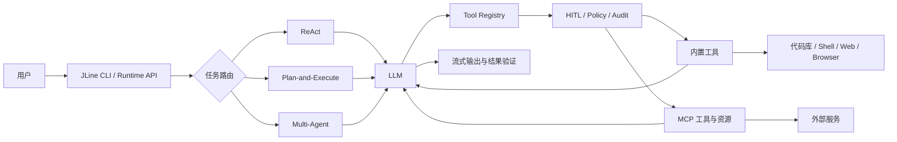

# JexCode

JexCode 是一个面向真实代码库的 Java AI Agent CLI。它以大模型为决策核心，连接代码库、终端、浏览器和 MCP 服务，可完成代码理解、任务规划、跨文件修改、命令执行与结果验证，形成从需求到交付的开发闭环。

## 核心能力

- **多种执行模式**：支持 ReAct、Plan-and-Execute 与 Multi-Agent，可处理单步操作、复杂任务规划和多角色协作。
- **代码库理解**：结合文件探索、Ripgrep、JavaParser 语法诊断与 RAG 语义检索定位代码和验证修改。
- **统一工具调用**：通过 Function Calling 调用文件、终端、搜索等内置工具，并支持同一轮无依赖工具并行执行。
- **MCP 扩展**：支持 stdio 与 Streamable HTTP，可动态发现并接入外部工具和资源。
- **上下文与记忆**：提供短期会话、长期记忆、项目级规则、上下文压缩和 Token 预算管理。
- **安全与恢复**：提供 HITL 审批、路径围栏、命令策略、操作审计及 Side-Git 快照回滚。
- **多入口交互**：支持流式终端、图片输入、Chrome DevTools 浏览器操作、后台任务、Runtime API 与微信 iLink 文本通道。

## 工作原理



一次任务的基本流程是：JexCode 读取用户输入并组装项目上下文，模型判断是直接回答还是调用工具；工具调用通过安全策略与人工审批后执行，结果回传给模型继续推理，直到完成修改、测试和最终回答。

## 快速开始

### 环境要求

- Java 17+
- Maven 3.8+
- 可选：Ripgrep，用于提升代码搜索速度
- 可选：Node.js，用于运行基于 npm 的 MCP Server
- 可选：Ollama，用于本地 Embedding 和 RAG 检索

### 安装与运行

```bash
git clone https://github.com/jjhong011001/JexCode.git
cd JexCode

cp .env.example .env
# 编辑 .env，至少配置一个可用的模型 API Key

mvn clean package
java -jar target/jexcode-1.0-SNAPSHOT.jar
```

例如使用 GLM：

```dotenv
GLM_API_KEY=your_api_key
GLM_MODEL=glm-5.1
```

也可以配置 DeepSeek、StepFun、Kimi、FreeLLMAPI、讯飞星辰 MaaS 或 Agnes。完整配置项见 [`.env.example`](.env.example)。

## 使用示例

直接用自然语言描述任务，默认进入 ReAct 模式：

```text
分析这个项目的登录流程，修复空指针问题并运行相关测试。
```

复杂任务可先规划再执行：

```text
/plan 重构订单模块，拆分领域服务，补充单元测试并验证构建结果。
```

需要角色分工时使用 Multi-Agent：

```text
/team 分析当前项目的性能瓶颈，完成优化并审查改动风险。
```

常见场景还包括：

```text
# 理解代码
找出支付回调的入口、调用链和异常处理逻辑。

# 跨文件修改
为用户模块增加分页查询接口，并补充参数校验和测试。

# 浏览器操作
打开本地页面，检查控制台报错并验证表单提交流程。

# 图片输入
分析 @image:/path/to/screenshot.png 中的报错并定位相关代码。
```

## 常用命令

| 命令 | 作用 |
|---|---|
| `/plan <任务>` | 使用 Plan-and-Execute 执行复杂任务 |
| `/team <任务>` | 使用 Multi-Agent 协作执行任务 |
| `/model <provider>` | 查看或切换模型 |
| `/index [路径]` | 为代码库建立语义索引 |
| `/search <问题>` | 使用 RAG 进行代码语义检索 |
| `/mcp` | 查看 MCP Server 和工具状态 |
| `/skill list` | 查看当前可用 Skill |
| `/browser connect` | 连接可复用登录态的 Chrome |
| `/memory list` | 查看长期记忆 |
| `/save <事实>` | 保存项目级长期记忆 |
| `/compact` | 手动压缩当前会话上下文 |
| `/snapshot` | 查看 Side-Git 快照 |
| `/restore <N>` | 恢复到指定的任务前快照 |
| `/hitl on` | 开启危险操作人工审批 |
| `/clear` | 清空当前会话，保留长期记忆 |

## MCP 扩展

JexCode 会合并用户级 `~/.jexcode/mcp.json` 与项目级 `.jexcode/mcp.json`，项目配置中的同名 Server 优先。MCP 工具会以 `mcp__{server}__{tool}` 的形式动态注册到 Agent。

```json
{
  "mcpServers": {
    "chrome-devtools": {
      "command": "npx",
      "args": ["-y", "chrome-devtools-mcp@latest", "--isolated=true"]
    },
    "remote-service": {
      "url": "https://mcp.example.com/v1",
      "headers": {
        "Authorization": "Bearer ${REMOTE_TOKEN}"
      }
    }
  }
}
```

`command` 用于 stdio Server，`url` 用于 Streamable HTTP Server。`${PROJECT_DIR}`、`${HOME}` 和环境变量可在配置中引用，敏感凭证应保存在 `.env` 或系统环境变量中。

## 配置与数据目录

| 位置 | 用途 |
|---|---|
| `.env` | 模型、Embedding、搜索和运行参数 |
| `~/.jexcode/config.json` | 用户级模型配置 |
| `~/.jexcode/mcp.json` | 用户级 MCP 配置 |
| `.jexcode/mcp.json` | 项目级 MCP 配置 |
| `JEXCODE.md` | 可提交到仓库的项目规则与上下文 |
| `JEXCODE.local.md` | 不提交的个人项目规则 |
| `~/.jexcode/memory/` | 长期记忆 |
| `~/.jexcode/logs/` | 运行日志 |
| `~/.jexcode/audit/` | 危险操作审计日志 |
| `~/.jexcode/snapshots/` | Side-Git 快照 |

## 安全机制

- 文件工具只能访问当前项目根目录，阻止路径越界。
- 命令策略会拒绝明显破坏性操作，并为命令设置超时。
- HITL 可在写文件、执行命令和调用外部 MCP 工具前请求确认。
- 审计日志会记录危险工具调用，并对 Token、Key 和 Authorization 等字段脱敏。
- Side-Git 在任务前后创建独立快照，不改写业务仓库的 Git 历史。

## 项目结构

```text
src/main/java/com/jexcode/
├── agent/       # ReAct、Plan-and-Execute、Multi-Agent
├── cli/         # 命令行入口、解析与补全
├── llm/         # 模型抽象与 Provider 实现
├── tool/        # 内置工具与统一注册中心
├── mcp/         # MCP 协议、传输、资源与配置
├── memory/      # 会话、长期记忆与上下文压缩
├── rag/         # 代码索引、Embedding 与语义检索
├── prompt/      # 分层 Prompt 组装
├── hitl/        # 人工审批
├── policy/      # 路径、命令与审计策略
├── snapshot/    # Side-Git 快照与恢复
├── browser/     # Chrome/CDP 会话管理
├── skill/       # Skill 发现、加载与状态管理
├── runtime/     # 后台任务与 Runtime API
└── render/      # Inline、Lanterna 与 Plain 渲染器
```

更详细的设计说明见 [`docs/`](docs/)。

## 开发与测试

```bash
# 快速回归
mvn test -Pquick

# 全量测试
mvn test -DskipTests=false
```

项目入口为 `com.jexcode.cli.Main`，默认构建产物为 `target/jexcode-1.0-SNAPSHOT.jar`。
