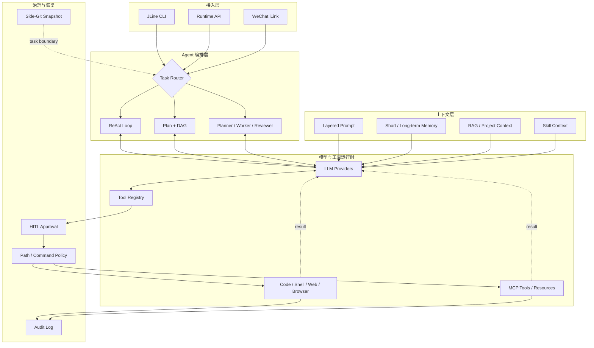

# JexCode

**Java-native AI Agent CLI for repository-scale software engineering.**

`Java 17` · `Agent Orchestration` · `Function Calling` · `MCP` · `RAG` · `Multi-Agent` · `HITL`

JexCode 是一个面向真实代码库的软件工程 Agent。它并非简单封装大模型对话接口，而是将**任务编排、上下文工程、工具运行时和安全治理**组合成完整执行系统，使模型能够理解代码、规划任务、修改文件、调用终端并验证结果。

## 核心设计

| 能力域 | 设计与实现 |
|---|---|
| **Agent 编排** | 提供 ReAct、Plan-and-Execute 和 Multi-Agent 三种执行模式，覆盖迭代式工具调用、DAG 任务规划与多角色协作 |
| **上下文工程** | 统一组装分层 Prompt、项目规则、会话历史、长期记忆、Skill、RAG 结果与 MCP Resources，并实施压缩和 Token 预算控制 |
| **工具运行时** | 基于 Function Calling 建立统一 Tool Registry，支持内置工具、并行调用、超时取消以及 MCP 动态工具发现 |
| **代码智能** | 结合实时文件探索、Ripgrep、JavaParser、Embedding 与 SQLite 向量检索完成代码定位、语义检索和修改后诊断 |
| **安全治理** | 通过 HITL、路径围栏、命令策略、凭证脱敏、操作审计和 Side-Git 快照控制工具执行风险 |
| **多入口交互** | 提供 JLine 流式 CLI、图片输入、Runtime API、后台任务、Chrome/CDP 浏览器操作和微信 iLink 文本通道 |

## 系统架构



一次任务会经过六个阶段：

1. **任务路由**：识别普通任务、计划任务或多 Agent 协作任务。
2. **上下文组装**：按预算加载项目规则、会话、记忆、Skill 和检索结果。
3. **模型决策**：模型生成回答或结构化 `tool_calls`。
4. **策略校验**：工具调用依次经过 HITL、路径与命令策略。
5. **执行反馈**：内置工具或 MCP 执行结果回灌模型，继续下一轮推理。
6. **验证交付**：按需运行诊断和测试，以流式方式输出最终结果并保留可恢复快照。

## 执行模式

| 模式 | 工作方式 | 适用任务 |
|---|---|---|
| **ReAct** | 模型在“思考—调用工具—观察结果”之间迭代，默认启用 | 代码问答、问题定位、局部修改 |
| **Plan-and-Execute** | 先生成带依赖关系的执行计划，经确认后按 DAG 批次执行 | 跨模块重构、迁移、复杂交付任务 |
| **Multi-Agent** | Planner 拆解、Worker 执行、Reviewer 审查并反馈修正 | 需要角色分工和质量复核的综合任务 |

CLI 执行期间可按 `Esc` 取消当前任务，任务退出后会回到输入提示符。`/task cancel <task_id>` 取消指定后台任务。

## 快速开始

### 运行要求

- Java 17+
- Maven 3.8+
- 可选：Ripgrep，用于加速代码搜索
- 可选：Node.js，用于运行 npm MCP Server
- 可选：Ollama，用于本地 Embedding

### 安装

```bash
git clone https://github.com/jjhong011001/JexCode.git
cd JexCode

cp .env.example .env
# 编辑 .env，至少配置一个可用的模型 API Key

mvn clean package
java -jar target/jexcode-1.0-SNAPSHOT.jar
```

最小配置示例：

```dotenv
GLM_API_KEY=your_api_key
GLM_MODEL=glm-5.1
```

JexCode 同时适配 GLM、DeepSeek、StepFun、Kimi、FreeLLMAPI、讯飞星辰 MaaS 和 Agnes，运行中可通过 `/model` 切换 Provider。完整参数见 [`.env.example`](.env.example)。

## 使用示例

默认使用 ReAct 执行任务：

```text
分析用户登录模块的调用链，修复可能的空指针问题并运行相关测试。
```

复杂任务先规划再执行：

```text
/plan 重构订单模块，拆分领域服务，补充单元测试并验证构建结果。
```

需要多角色协作与复核时：

```text
/team 分析当前项目的性能瓶颈，完成优化并审查改动风险。
```

也可以附加本地上下文或图片：

```text
解释 @src/main/java/com/example/OrderService.java 的核心流程。
分析 @image:/path/to/error.png 中的报错并定位相关代码。
```

## MCP 工具生态

JexCode 同时支持 stdio 与 Streamable HTTP。启动时会加载用户级 `~/.jexcode/mcp.json` 和项目级 `.jexcode/mcp.json`，完成初始化、能力协商和工具发现，再将工具注册为 `mcp__{server}__{tool}` 供模型调用。

```json
{
  "mcpServers": {
    "chrome-devtools": {
      "command": "npx",
      "args": ["-y", "chrome-devtools-mcp@latest", "--isolated=true"]
    },
    "remote-service": {
      "url": "https://mcp.example.com/v1",
      "headers": {
        "Authorization": "Bearer ${REMOTE_TOKEN}"
      }
    }
  }
}
```

- `command` 定义 stdio Server，`url` 定义 Streamable HTTP Server。
- 项目级同名配置覆盖用户级配置。
- `${PROJECT_DIR}`、`${HOME}` 和 `${VAR}` 支持运行时变量展开。
- MCP Tools、Resources 和变更通知统一接入 Tool Registry。
- Token、Key 和 Authorization 等凭证只从 `.env` 或系统环境变量注入。

## 上下文与记忆

| 类型 | 作用 | 生命周期 |
|---|---|---|
| **会话历史** | 保存当前对话和工具调用链 | 当前会话，可压缩或清空 |
| **项目上下文** | 通过 `JEXCODE.md` 固化项目架构、命令和约束 | 随代码库共享 |
| **长期记忆** | 保存用户明确要求记录的稳定事实与偏好 | 跨会话，可检索和删除 |
| **RAG 索引** | 对代码分块、向量化并进行语义召回 | 持久化到 SQLite |
| **Skill Context** | 根据任务按需加载专业操作手册 | 单次任务按需注入 |

上下文接近模型窗口上限时，JexCode 会压缩较早的会话内容，并结合当前 Provider 的上下文窗口实施 Token 预算控制，避免无限累积历史消息。

## 安全与可恢复性

工具调用不是直接执行，而是经过统一治理链路：

```text
Tool Call → HITL → Tool Registry → PathGuard / CommandGuard → Execute → Audit
```

- **最小访问边界**：文件工具只能访问当前项目根目录。
- **危险命令拦截**：拒绝明显破坏性命令，并设置执行超时。
- **人工审批**：写文件、执行命令和外部 MCP 调用可要求用户确认。
- **操作审计**：危险调用按 JSONL 记录，敏感参数自动脱敏。
- **独立快照**：Side-Git 在任务边界保存工作区状态，快照的 Git 元数据存放在独立目录。初始化快照时保留项目原有的 Git 配置。

## 常用命令

| 分类 | 命令 |
|---|---|
| 执行模式 | `/plan <任务>`、`/team <任务>`、`/cancel` |
| 模型与上下文 | `/model`、`/context`、`/compact`、`/clear` |
| 代码检索 | `/index [路径]`、`/search <问题>`、`/graph <类名>` |
| MCP 与 Skill | `/mcp`、`/mcp restart <name>`、`/skill list`、`/skill show <name>` |
| 记忆 | `/memory list`、`/memory search <关键词>`、`/save <事实>` |
| 安全与恢复 | `/hitl on`、`/policy`、`/audit`、`/snapshot`、`/restore <N>` |
| 浏览器 | `/browser status`、`/browser connect`、`/browser disconnect` |
| 任务与会话 | `/task`、`/task add <任务>`、`/export`、`/exit` |

## 技术栈

| 模块 | 技术 |
|---|---|
| Runtime | Java 17、Maven |
| Terminal UI | JLine 4、Lanterna |
| LLM Integration | OkHttp、Jackson、SSE、Function Calling |
| Code Intelligence | Ripgrep、JavaParser、Embedding、RAG |
| Storage | SQLite、JSONL |
| Tool Ecosystem | MCP stdio、Streamable HTTP、Chrome DevTools Protocol |
| Engineering | JGit、SLF4J、Logback、JUnit 5 |

## 项目结构

```text
src/main/java/com/jexcode/
├── agent/       # Agent 执行与编排
├── cli/         # CLI 入口、命令解析与补全
├── llm/         # LLM 抽象与 Provider
├── prompt/      # 分层 Prompt 组装
├── memory/      # 会话、长期记忆与上下文压缩
├── rag/         # 代码索引与语义检索
├── tool/        # 内置工具与 Tool Registry
├── mcp/         # MCP 协议、传输和资源
├── skill/       # Skill 发现与按需加载
├── hitl/        # 人工审批
├── policy/      # 路径、命令和审计策略
├── snapshot/    # Side-Git 快照与恢复
├── browser/     # Chrome/CDP 会话管理
├── runtime/     # 后台任务与 Runtime API
└── render/      # Inline、Lanterna 与 Plain 渲染
```

配置与运行数据默认保存在 `~/.jexcode/`，项目级配置位于 `.jexcode/`。更详细的设计说明见 [`docs/`](docs/)。

## 开发与测试

```bash
# 快速回归
mvn test -Pquick

# 全量测试
mvn test -DskipTests=false
```

主入口为 `com.jexcode.cli.Main`，默认构建产物为 `target/jexcode-1.0-SNAPSHOT.jar`。
